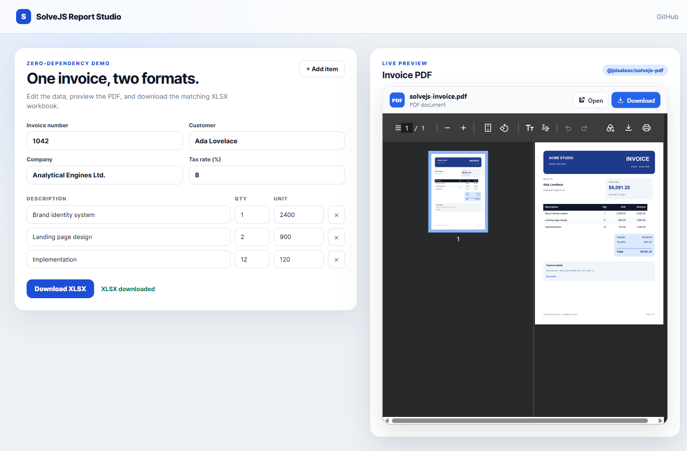

# Report Studio

A framework-free demo that turns one editable invoice dataset into two real deliverables:

- a paginated, print-ready **PDF** rendered with `@jdsalasc/solvejs-pdf` and shown with `<solvejs-pdf-viewer>`;
- a matching **XLSX** workbook written with `@jdsalasc/solvejs-xlsx`, including formulas with cached values, print setup, frozen headers, an auto-filter and defined names.



## Run it

Build the workspace packages once, then start the demo server:

```bash
npm run build
npm run example:studio
```

Open <http://localhost:4174>. The server is a single zero-dependency Node file that serves the app and the package `dist/esm` folders. Use `PORT=5000 npm run example:studio` to pick another port.

## What to look at

1. Edit the invoice number, customer, company, tax rate or line items. The PDF preview updates after every change.
2. Click **Download XLSX** and open the file in Excel or LibreOffice. The amount cells use `B7*C7`-style formulas with cached results, so the sheet is useful before a recalculation.
3. Check **Page Layout** in the spreadsheet: A4, fit to one page, frozen header rows and `InvoiceTotal` as a defined name. Column B has a whole-number validation rule for quantities.
4. Open the PDF outline/bookmarks panel in the viewer to jump to **Invoice**, **Line items** or **Payment details**.
5. Click **Download** in the PDF viewer to save the same data as a PDF.

## Files

| File | Purpose |
|---|---|
| `index.html` | Layout, import map and the `solvejs-pdf-viewer` element |
| `app.js` | State, PDF document, workbook, viewer wiring and DOM events |
| `styles.css` | Demo UI styles |
| `server.mjs` | Static server for the app and the built packages |
| `screenshot.png` | Visual reference of the finished app |

## Why this is a good integration test

The app exercises the parts that usually break in a real report:

- one dataset driving two format-specific layouts;
- money formatting kept consistent between PDF and XLSX;
- cached formula results so the workbook opens with values;
- links, page setup and defined names;
- PDF pagination and the browser viewer lifecycle;
- no framework, no bundler and no runtime dependencies in either package.
